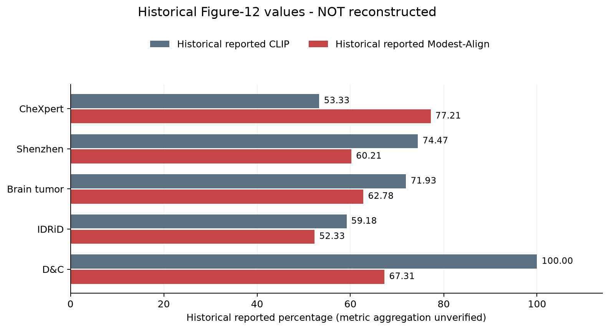
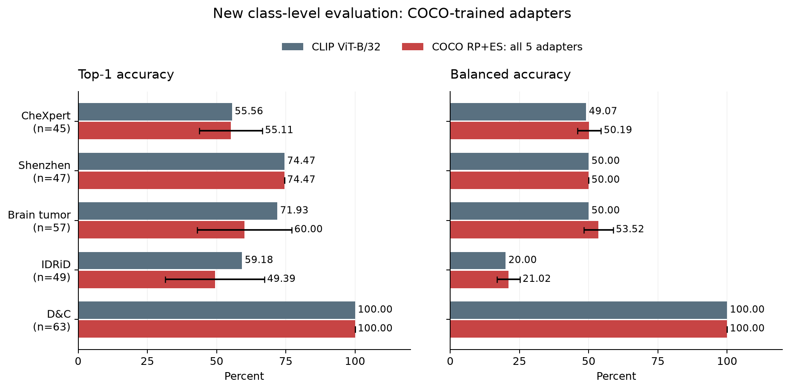
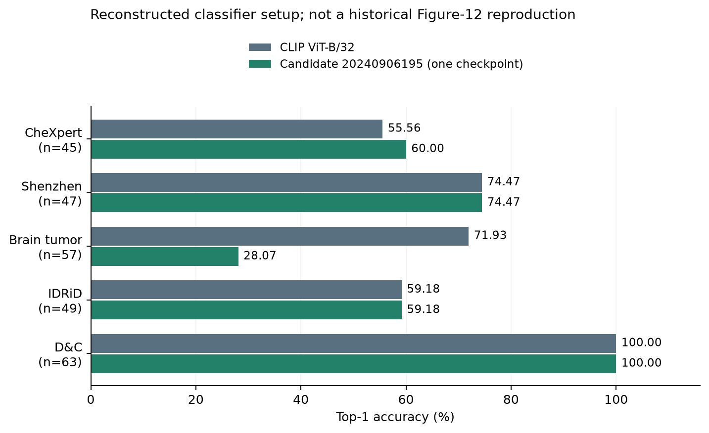
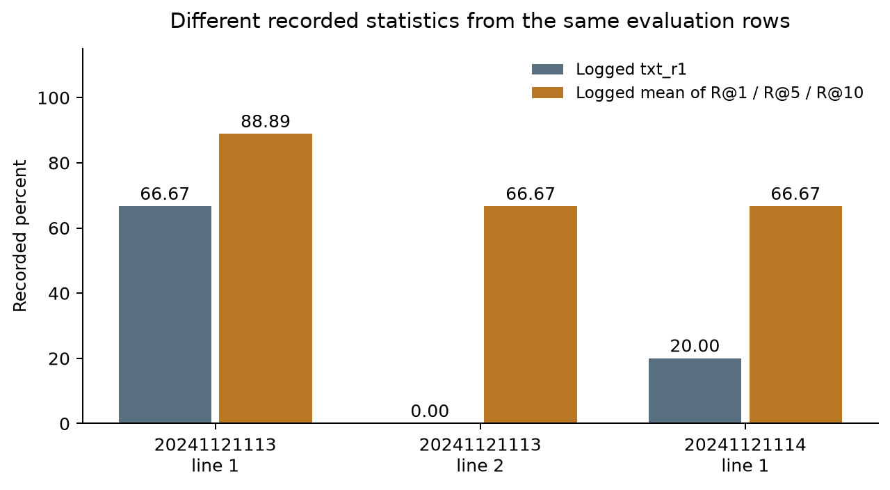
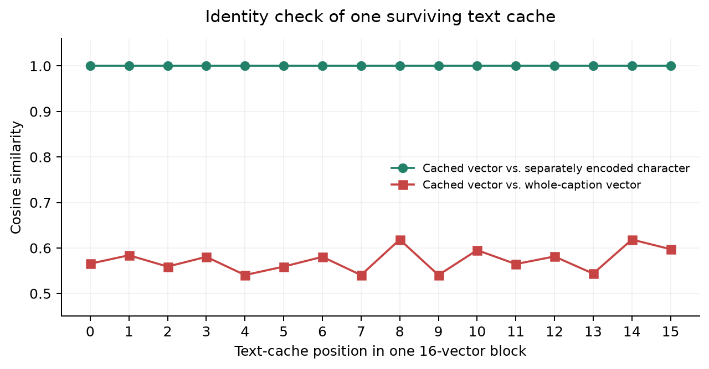

# Figure 12: Data, Figures and Complete Arithmetic

This supplement brings together the reported Figure 12 values, archived
retrieval records, and two documented class-level reevaluations. Each
section identifies its data source, evaluation setting, and available
calculation records.

## Read This First

The authors' clarification of the original approximately-50-image subsets,
multi-seed Modest-Align mean and single CLIP evaluation is recorded separately
in [HISTORICAL_AUTHOR_CLARIFICATION.md](HISTORICAL_AUTHOR_CLARIFICATION.md).
That procedural account is attributed to the authors; it does not turn the
retained artifacts into a complete numerical reconstruction. The `3 x 50`
test below is one specific hypothesis, not a test of all multi-seed protocols.

| Material | What is established | What is not established |
| --- | --- | --- |
| Historical Figure-12 percentages | The numbers reported in the earlier manuscript | Exact group inputs, metric field and aggregation for all five values |
| 36 surviving retrieval metric rows | Every recorded field and its recall-average arithmetic | A complete ledger of every historical experiment or a mapping to all five final values |
| New COCO evaluation | 261 fixed images; all five adapter seeds; full scores and class-level metrics | Reproduction of the historical 3.5M-trained experiment |
| Candidate 20240906195 | A separate one-checkpoint evaluation with a documented reconstructed classifier | The historical classifier initializer and original Figure-12 execution identity |
| Text-cache fingerprint | One surviving cache matches separately encoded characters | That every historical group used this cache |

**No seeds, datasets or unfavorable outcomes are excluded.** None of the
plots should be relabeled as evidence for an experiment in a different row.

## One-Command Arithmetic Reproduction

Python 3.9 or later, with the standard library only:

```bash
python recompute.py --check-manifest
python -m unittest -v test_recompute.py
```

The first command independently recalculates **1,827 image decisions,
35 classification cells, all five COCO adapter seeds, 36 retrieval rows,
and 48 text-cache vector comparisons**. It checks supplied summaries rather
than trusting them and fails on missing seeds, extra samples, inconsistent
class labels, nonfinite scores or altered predictions.

The full step-by-step output is [CALCULATIONS.md](CALCULATIONS.md).
Every image decision is in [per_image_calculations.csv](per_image_calculations.csv),
with every per-class numerator and denominator in
[per_class_calculations.csv](per_class_calculations.csv).

## Figures

### Historical Values, Without Inventing Their Calculation



This is a display of the historical percentages, **not a validation or
reconstruction**. No unverified historical sample counts or error bars are
attached to it. The missing old aggregation is not replaced with a guessed
three-run average.

### New COCO-Trained Adapter Evaluation



This is a **new evaluation**, not the old Figure-12 run. Error bars are sample
standard deviations across all adapter-training seeds 0, 1, 3, 7 and 42.
CLIP is one fixed model. Chance-level balanced accuracy on several medical
subsets must not be interpreted as evidence of medical discrimination.

### Separate Candidate-Checkpoint Evaluation



The candidate 20240906195 is one checkpoint, not a five-seed mean. The
classifier is explicitly reconstructed from projected class prompts; its
historical initializer was not recovered. Original training RP/ES settings
are not fully recorded in that checkpoint configuration.

### Recorded Retrieval Fields Are Different Quantities



These are three actual retained metric rows. For example, R@1=20,
R@5=80 and R@10=100 give a mean of 66.67. That mean is not R@1 or a
class-level classification accuracy merely because it is a percentage.
All 36 rows, not only these examples, are in the released ledger.

### Text-Cache Identity Check



This applies to **one surviving cache only**. Its 50 dictionary entries
comprise 48 text vectors and two maps, paired with three image features.
The released generic text vectors permit independent verification of the
character-versus-whole-caption identity test. No medical image vectors are
distributed.

## Regenerate the Figures

```bash
python -m pip install -r requirements-figures.txt
python plot.py
```

Five PNG/PDF pairs are generated from the supplied data. The historical
display is explicitly not a reconstruction; the other four plots use
recomputed values. No result numbers are hard-coded into the plotting logic.
The plotting environment used for
this bundle is recorded in `environment.json`.

## What Can Be Reproduced

This bundle reproduces **the full arithmetic from per-class cosine scores
to predictions, counts, accuracies, per-class recall, seed means and sample
SDs**. It is not a self-contained pixel-level inference or training package:
the underlying dataset images and model weights are not included.

See [PROTOCOL.md](PROTOCOL.md) for model stages, checkpoint hashes,
preprocessing, class prompts, metric formulas and limitations.
The source-score and original-log file hashes are in `provenance.json`.
`manifest.json` pins every released file. For a review citation, prefer an
immutable Git commit or release rather than a mutable default-branch link.

## Privacy and Rights

No private chat screenshots, reviewer correspondence, patient identifiers,
original medical images, image-content hashes, absolute server paths,
access credentials or model checkpoints are included. Public sample IDs
are dataset-local indices shared across the evaluations.

Dataset and model rights remain with their original providers. This
supplement does not grant permission to redistribute their source images
or weights. No new license for upstream material is asserted here.

## Historical Values

The historical numbers are retained verbatim in
`historical_reported_values.csv`, with an explicit provenance limitation.
They are **not** labeled as recomputed outputs or silently replaced by
arithmetically convenient values. The supplied arithmetic checks reject
only particular counting hypotheses, not every possible historical
aggregation. The exact old group-to-number aggregation remains unresolved.
